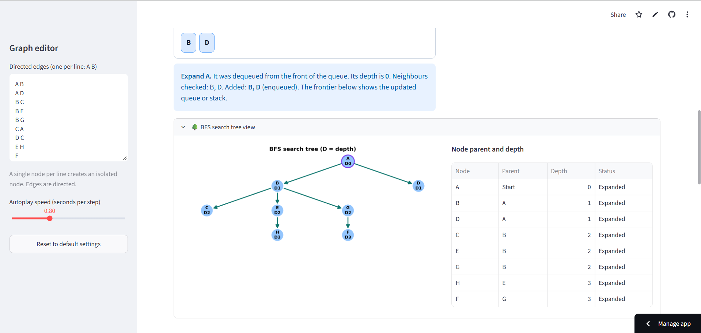

## Interactive BFS & DFS Search Visualizer

An interactive web application built with **Streamlit**, **NetworkX**, and **Matplotlib** to demonstrate and compare **Breadth-First Search (BFS)** and **Depth-First Search (DFS)** algorithms step-by-step on customizable directed graphs.

**BSD3513 Artificial Intelligence — Lab Report 1** **Wong Ka Seng** **UMPSA**.

---

🌐 Live Application
Access the deployed interactive web application directly in your browser:

👉 https://labreport1sd24037.streamlit.app/

---

## 📸 Screenshots & Showcase

### Main Interface


### Algorithm Visualizations & Tree Views

| Search Execution | Search Tree View |
| :---: | :---: |
| **BFS Execution**<br> | **BFS Tree View & Explanation**<br> |
| **DFS Execution**<br> | **DFS Tree View & Explanation**<br> |

### Algorithm Comparison Table


### Algorithm Comparison Table

---

## 📌 Overview

This tool provides a complete educational sandbox for understanding uninformed search strategies. Users can input custom directed graphs or use built-in defaults, select start and goal nodes, and observe how BFS and DFS traverse the graph, expand frontiers, build search trees, and identify optimal paths.

---

## ✨ Key Features

* **Interactive Graph Editor**: Custom text-based graph input format supporting directed edges and isolated nodes.
* **Dual Algorithm Engine**: Step-by-step execution for both **BFS** (using FIFO `deque`) and **DFS** (using LIFO `list` stack).
* **Step-by-Step Execution Trace**:
* Visual node coloring (Current, Expanded, Frontier, Undiscovered).
* Highlighted search tree edges and goal paths.
* Real-time frontier structure renderer (Queue vs. Stack visual cards).
* Plain-English step explanations describing dequeues/pops, neighbor checks, and skips.


* **Playback Controls**: Step forward/backward manually or use variable-speed **Autoplay**.
* **Search Tree Visualization**: Dynamic tree view rendering node depths ($D0, D1, \dots$) and parent-child hierarchy.
* **Side-by-Side Algorithm Comparison**:
* Data structures used (FIFO queue vs. LIFO stack).
* Expansion order sequence.
* Total expanded nodes & maximum frontier memory size.
* Goal path comparison (highlighting BFS minimum-hop optimality in unweighted graphs).


---

## 🛠️ Tech Stack & Dependencies

* **Language**: Python 3.9+
* **Web Framework**: Streamlit
* **Graph Logic & Rendering**: NetworkX, Matplotlib
* **Data Processing**: Pandas

---

## 🚀 Getting Started

### Prerequisites

Ensure you have Python 3.9 or higher installed on your system.

### Installation

1. **Clone the repository**:
```bash
git clone https://github.com/your-username/your-repo-name.git
cd your-repo-name

```


2. **Create and activate a virtual environment** *(optional but recommended)*:
```bash
# Windows
python -m venv venv
venv\Scripts\activate

# macOS / Linux
python3 -m venv venv
source venv/bin/activate

```


3. **Install dependencies**:
```bash
pip install streamlit networkx matplotlib pandas

```


---

## 🏃 Running the Application

Launch the Streamlit app using the following command in your terminal:

```bash
streamlit run app.py

```

Replace `app.py` with the filename containing your code if named differently.

---

## 📖 Usage & Input Format

### Defining Graph Edges

In the sidebar **Graph editor**, enter directed edges line-by-line using two space-separated node labels:

```text
A B
A D
B C
B E
B G
C A
D C
E H
F
G F
H F
H G

```

* **Directed Edge**: `A B` creates a directed edge from node `A` to node `B`.
* **Isolated Node**: Entering a single node on a line (e.g., `F`) defines an isolated node.
* **Comments**: Any text after `#` is ignored.

### Default Graph Visual Layout

The default graph shipped with the application uses the following adjacency layout:

| Node | Successors (Outgoing Edges) |
| --- | --- |
| **A** | B, D |
| **B** | C, E, G |
| **C** | A |
| **D** | C |
| **E** | H |
| **F** | *(None / Isolated)* |
| **G** | F |
| **H** | F, G |

---

## 📊 Theoretical Summary: BFS vs DFS

| Property | Breadth-First Search (BFS) | Depth-First Search (DFS) |
| --- | --- | --- |
| **Frontier Structure** | FIFO Queue | LIFO Stack |
| **Time Complexity** | $O(\vert{}V\vert{} + \vert{}E\vert{})$ | $O(\vert{}V\vert{} + \vert{}E\vert{})$ |
| **Space Complexity** | $O(\vert{}V\vert{})$ (High frontier memory usage) | $O(\vert{}V\vert{})$ (Proportional to max depth) |
| **Path Quality** | Guarantees minimum-hop shortest path | Non-optimal (depends on expansion order) |
| **Exploration Style** | Level-by-level | Branch-by-branch |

---
